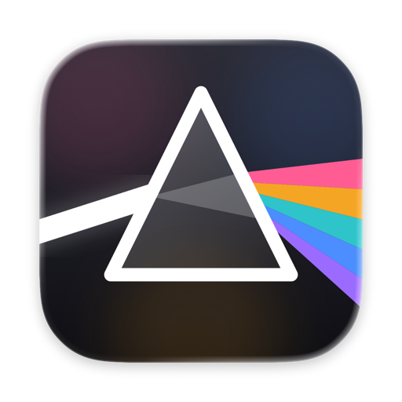
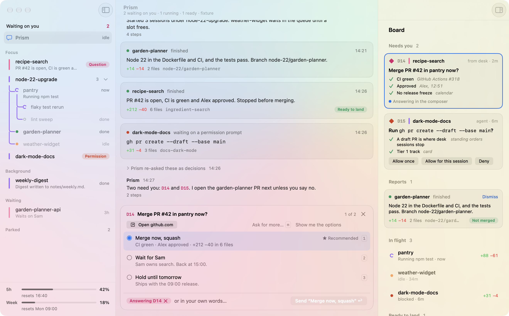
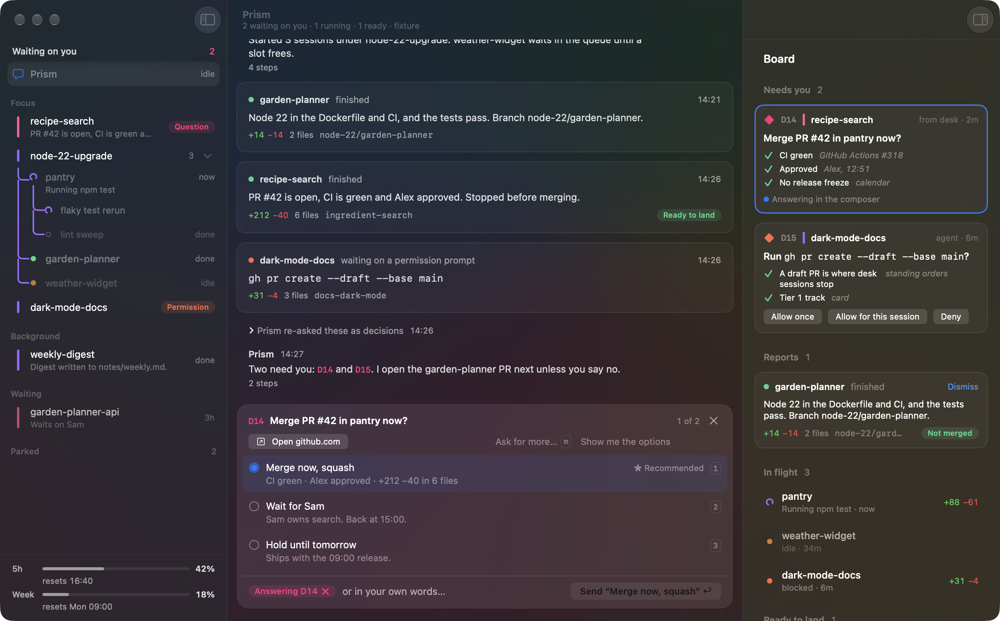
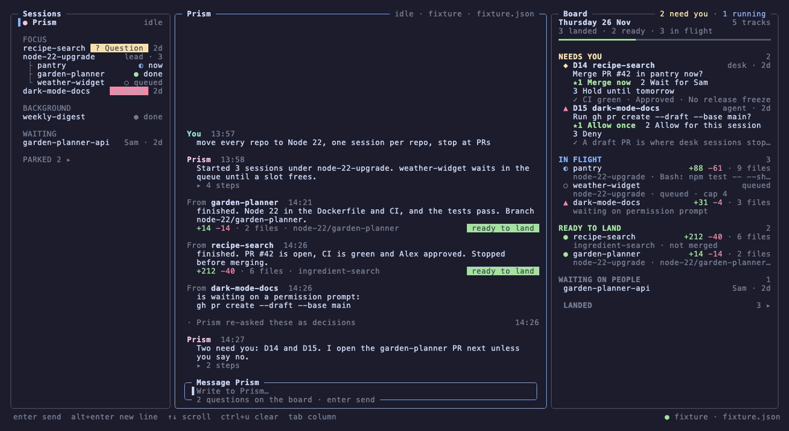
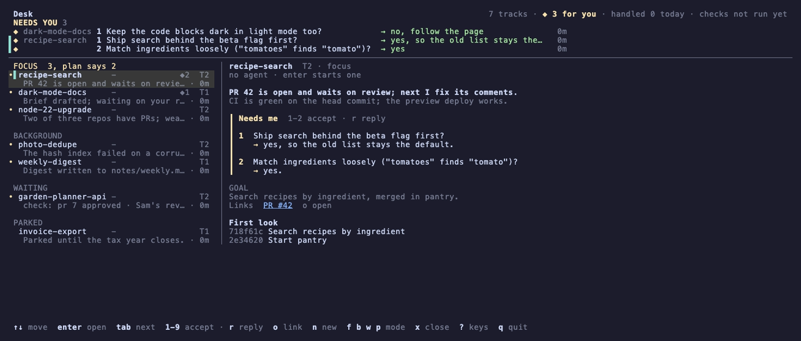

<p align="center"></p>

# Prism

Prism is a desk for running many Claude Code sessions at once without reading their scrollback. You talk to one agent, the desk. It starts sessions in the background, watches them, and brings you only what is yours to decide: a question with options, the evidence behind it and a recommendation. Everything else runs under standing orders.

The repo is called `tracks`, after the unit Prism is built on. The command-line tool is `tracks`, and `prism` runs the server and the terminal window.



## Why

Two weeks of steering agents by hand (2-16 Nov 2026, 480 interventions) showed that about a third of the typing was avoidable: go-aheads ("merge it"), news from outside the session ("I merged them") and asking where things stand. Prism removes those three. The rest, direction and answers, is the job itself, so Prism only batches it.

## How it works

```
 you ──▶ Prism.app / prism tui ──▶ prism server ──▶ desk (a headless Claude session)
                    ▲                  │                 │ tracks start
                    │ snapshot +       │                 ▼
                    │ change stream    │         track sessions (claude --bg)
                    │                  ▼                 │ hooks, tracks card
                    └────────────── tracks.db ◀──────────┘
```

**Tracks.** A track is one working sphere: an epic, an investigation, or something waiting on another person. It has a goal, a mode (focus, background, waiting, parked), a risk tier (1-3), and a card that says where it stands and what it needs from you. The agent working on it keeps the card current with `tracks card`, and a Stop hook copies the first line of each reply into it. The state lives in SQLite (`$TRACKS_HOME/tracks.db`); the Markdown cards are rendered from it.

**Sessions.** A session is one Claude Code conversation working on a track. Sessions the desk starts run in the background with no terminal (`claude --bg`), report to the desk when they stop, and stop at a commit or a PR. A lead session can split a goal into threads, each a session of its own, and check their work before reporting. Status (idle, working, blocked, done, error) comes from Claude Code hooks, never from reading a screen.

**The desk.** The desk is a headless Claude session that `prism server` runs. You tell it what you want in plain words; it starts tracks for it, nudges stuck sessions, merges and installs within its standing orders, and logs what it handled. It only acts on sessions it owns. Once you type into a session yourself, that session is yours and the desk only reads it.

**Decisions.** Anything that needs you becomes a decision: an id such as `D14`, the question, up to nine options, the evidence with sources, and the recommended option. A session's own asks, a check that changed (`pr 418 approved`) and a permission prompt all land in the same queue. You answer with one key, and Prism types the answer into the session when it is free.

**Tiers and standing orders.** A track's tier is set by the riskiest thing it touches, and it decides what the agent may do alone: tier 1 commits and merges, tier 2 opens and lands reviewed PRs, tier 3 stops at a reviewed PR and asks before anything that can't be undone. Standing orders (`tracks orders`) only ever hold agents back.

**Checks.** `tracks check` runs every 10 minutes under launchd and checks what waiting tracks wait on (`pr N approved`, `ci BRANCH green`). When the answer changes, it wakes the track's session or puts a question in the queue, so you never type "CI is green now".

## The windows

**Prism.app** (macOS 26, SwiftUI): sessions on the left, the conversation with the desk in the middle, the board on the right with what needs you, what is in flight, and what is ready to land.

<p align="center"></p>

**prism tui**: the same three columns in a terminal, for when you are already in one.



**The tracks pane** (`tracks`): one line per track grouped by mode, the asks waiting on you at the top, and the selected card on the right. Keys are in [docs/keys.md](docs/keys.md).



## Install

Needs Go, macOS, [Claude Code](https://claude.com/claude-code), and Xcode for the app's icon.

```sh
make install install-skills   # tracks and prism into ~/.local/bin; /track, /lead and /desk into ~/.claude/skills
make install-check            # tracks check every 10 minutes under launchd
cd mac && make install        # Prism.app into ~/Applications
```

Open Prism; it starts `prism server` itself. `prism tui` works the same way. Both take `--fixture mock/serve-fixture.json` to run on sample data without touching `tracks.db`.

In any Claude Code session, `/track NAME` binds the session to a track and keeps its card, and `/lead GOAL` leads a goal through threads.

The skills are written for one person's way of working (the person is called Emil in them): read them and make them yours before you rely on them.

## Settings

All optional, as environment variables:

| Variable | What |
|---|---|
| `TRACKS_HOME` | Where `tracks.db` and the cards live (default `~/.local/state/tracks`). |
| `TRACKS_DEFAULT_DIR` | The directory a new track starts in (default `~/Developer`). |
| `TRACKS_ISSUE_URLS` | Where ticket keys in `links:` open, as `PROJECT=URL` pairs with `*` for every other project: `EMI=https://linear.app/you/issue/,*=https://you.atlassian.net/browse/`. Without it, keys are not links. |
| `TRACKS_GH_ACCOUNTS` | For more than one `gh` login: which login `tracks check` uses, as `owner=login` or `~/dir=login` pairs: `acme=me-at-acme,~/Developer/acme=me-at-acme`. Without it, gh's own login. |
| `TRACKS_LEAN_SKILLS_OFF`, `TRACKS_LEAN_PLUGINS_OFF` | Skills and plugins (`name@marketplace`) the sessions the desk starts turn off, comma-separated, to cut their start-up context. |

## Layout

| Path | What |
|---|---|
| `cmd/tracks`, `cmd/prism` | The two binaries; both are thin wrappers around `internal/tracks`. |
| `internal/tracks` | The CLI, the pane, `prism server`, `prism tui`, hooks, checks, resume. |
| `internal/store` | `tracks.db`: schema, migrations, card rendering. |
| `mac/` | Prism.app (SwiftPM; `DeskCore` holds the logic, `Prism` the UI). See [mac/CLAUDE.md](mac/CLAUDE.md). |
| `skill/` | The `track`, `lead` and `desk` skills the agents follow. |
| `mock/` | Fixtures for the app, the TUI and screenshots. |
| `docs/` | Design docs: [serve API](docs/serve-api.md), [desk v3](docs/desk-v3.md), [store](docs/store.md), [modes](docs/track-modes.md). |

## Development

```sh
make test            # Go tests
make audit           # every pane state as an ANSI capture, into audit-out/
cd mac && make test  # app tests
cd mac && make shots # window captures from the fixture, in the background
```

The README's pictures use made-up data only: `cd mac && make readme-shots` captures the app from `docs/readme/fixture.json`, and `prism tui --fixture docs/readme/fixture.json` shows the same data in a terminal.

How this repo is built and reviewed is in [CLAUDE.md](CLAUDE.md).

## Licence

MIT, see [LICENSE](LICENSE).
